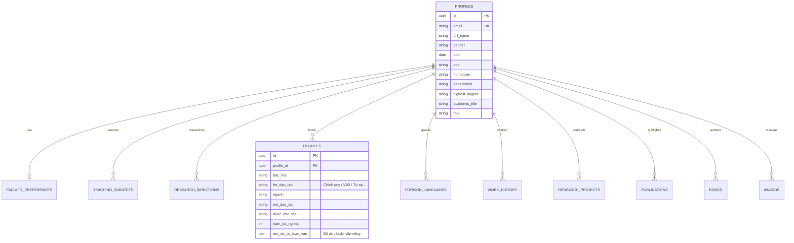

<div align="center">

# 🎓 CỔNG THÔNG TIN LÝ LỊCH KHOA HỌC & QUẢN LÝ GIẢNG VIÊN HCMUTE
### *HCMUTE Scientific CV & Faculty Management Portal*

[](https://react.dev/)
[](https://vitejs.dev/)
[](https://nodejs.org/)
[](https://supabase.com/)
[](https://tailwindcss.com/)
[]()
[](LICENSE)

*Hệ thống quản lý hồ sơ nhà khoa học, tra cứu giảng viên và xuất lý lịch khoa học chuẩn mẫu Bộ Giáo dục & Đào tạo dành cho Trường Đại học Sư phạm Kỹ thuật TP. Hồ Chí Minh.*

---

</div>

## 🌟 Giới Thiệu Tổng Quan

**HCMUTE Scientific CV Portal** là giải pháp phần mềm hiện đại được thiết kế nhằm số hóa toàn diện hồ sơ năng lực của đội ngũ giảng viên, nghiên cứu sinh và nhà khoa học. Dự án giải quyết triệt để sự phân mảnh dữ liệu, thay thế hoàn toàn các phương thức lưu trữ thủ công bằng kiến trúc web hiện đại phân lớp:

- ⚡ **Frontend**: Single Page Application (SPA) xây dựng bằng **React 18**, **Vite** siêu tốc và **Tailwind CSS**.
- 🚀 **Backend**: RESTful API linh hoạt chạy trên **Node.js** & **Express**.
- 🐘 **Cơ sở dữ liệu**: Đám mây **Supabase (PostgreSQL 15+)** với chính sách bảo mật đa tầng (Row Level Security - RLS).
- 📑 **Tiêu chuẩn biểu mẫu**: Xuất file Word (`.docx`) và PDF A4 đồng bộ 100% với **Phụ lục III - Thông tư 09/2017/TT-BGDĐT**.

---

## ✨ Tính Năng Nổi Bật

### 1. 🗂️ Quản Lý Đầy Đủ 7 Hạng Mục Lý Lịch Khoa Học
Hồ sơ được chuẩn hóa thành 7 phân hệ chuyên biệt:
1. **Thông tin cơ bản**: Họ tên, CCCD, chức vụ, học vị cao nhất, chức danh khoa học (GS/PGS), liên hệ.
2. **Thông tin bổ sung & Nguyện vọng**: Hình thức hợp tác (thỉnh giảng, nghiên cứu, hội đồng, hướng dẫn NCS), danh mục môn giảng dạy và định hướng nghiên cứu mũi nhọn.
3. **Quá trình đào tạo chuyên sâu**: 
   - 📌 **Tách biệt rõ ràng**: Hệ đào tạo (*Chính quy, Văn bằng 2, Từ xa, Vừa làm vừa học, Chất lượng cao*) và Tên đề tài/luận văn tốt nghiệp riêng biệt.
   - Trình độ ngoại ngữ và cấp độ sử dụng.
4. **Quá trình công tác**: Mốc thời gian, cơ quan, chức vụ công tác.
5. **Đề tài & Dự án NCKH**: Quản lý đề tài cấp Nhà nước, cấp Bộ, Tỉnh/Thành phố, cấp Trường và Cơ sở.
6. **Công bố khoa học & Sách**:
   - Bài báo khoa học quốc tế (ISI/Scopus) và trong nước (HĐGSNN).
   - Giáo trình, sách tham khảo và sách chuyên khảo.
7. **Khen thưởng & Giải thưởng**: Giải thưởng KH&CN, danh hiệu nhà giáo ưu tú các cấp.

### 2. 🖨️ Bộ Sinh Biểu Mẫu Phụ Lục III (CV Export Engine)
- **Xem trước trực quan (Live A4 Preview)**: Giao diện mô phỏng trang in A4 chuẩn xác từng dòng, canh lề tiêu chuẩn quốc gia.
- **Xuất Microsoft Word (`.docx`)**: Tự động sinh file Word OpenXML chuẩn desktop, không vỡ định dạng bảng biểu.
- **In ấn & Lưu PDF**: Tích hợp print stylesheet cho phép lưu file PDF sắc nét từng chi tiết.
- **Tùy chọn linh hoạt**: Bật/tắt xuất kèm Mục V (Sách/Giáo trình) và Mục VI (Giải thưởng KH&CN).

### 3. 📥 Bộ Bóc Tách Dữ Liệu Thông Minh (CV Import Engine)
- **Tệp tin JSON**: Độ chính xác tuyệt đối 100%, bảo toàn toàn bộ cấu trúc mảng và quan hệ dữ liệu.
- **Tệp tin Word (`.docx`)**: Tự động trích xuất nội dung bằng thuật toán phân tích cú pháp biểu mẫu.
- **Chế độ nhập đa dạng**: Chọn giữa **Hòa trộn (Merge)** hoặc **Ghi đè (Overwrite)**.

### 4. 🛡️ Cổng Quản Trị Viên (Admin Candidate Portal)
- Dashboard thống kê trực quan số lượng Giáo sư, Phó Giáo sư, Tiến sĩ, Thạc sĩ.
- Bộ lọc đa tiêu chí: Lọc theo Khoa/Bộ môn, Học vị, Chức danh khoa học.
- Tìm kiếm tức thời theo từ khóa họ tên, email, lĩnh vực nghiên cứu.
- Trực tiếp xem và xuất Phụ lục III cho bất kỳ giảng viên nào trong hệ thống.
- Module phân quyền Admin bảo mật cao.

---

## 🏗️ Kiến Trúc Hệ Thống (Architecture)

```mermaid
graph TD
    subgraph Client ["Client Tier (React 18 + Vite)"]
        UI["SPA Interface (Tailwind CSS)"]
        State["Profile & Auth Context"]
        ExEngine["Phụ lục III Export Service"]
        ImEngine["Smart Import Engine"]
        UI --> State
        UI --> ExEngine
        UI --> ImEngine
    end

    subgraph Server ["Server Tier (Node.js + Express)"]
        API["REST API Router (/api)"]
        AuthMid["JWT & Auth Middleware"]
        Controllers["Controllers (Profile, Candidate, Admin)"]
        API --> AuthMid --> Controllers
    end

    subgraph Database ["Data Tier (Supabase / PostgreSQL)"]
        Tables[("PostgreSQL Tables (12 tables)")]
        RLS["Row Level Security Policies"]
        Tables --> RLS
    end

    Client -->|HTTP / JSON Requests| Server
    Client -.->|Direct Query (Optional)| Database
    Server -->|PostgreSQL Service Client| Database
```

---

## 🗄️ Sơ Đồ Cơ Sở Dữ Liệu (Database Schema)

Cơ sở dữ liệu được thiết kế tối ưu trên PostgreSQL với 12 bảng thực thể liên kết chặt chẽ:



---

## 📁 Cấu Trúc Thư Mục Dự Án

```
scientist-profile-hcmute/
├── client/                     # Ứng dụng Frontend (React + Vite)
│   ├── public/                 # Static assets (Favicon, Logo)
│   ├── src/
│   │   ├── components/
│   │   │   ├── admin/          # Admin Dashboard & Candidate Directory
│   │   │   ├── layout/         # Header, Navbar, Sidebar
│   │   │   ├── modals/         # Export Phụ lục III, Import, Phân quyền
│   │   │   └── sections/       # 7 Phân hệ hồ sơ khoa học
│   │   ├── context/            # AuthContext, ProfileContext
│   │   ├── services/           # API client, Supabase, Word/PDF engines
│   │   ├── App.jsx             # Root component
│   │   └── main.jsx            # Entry point
│   ├── index.html
│   ├── vite.config.js
│   └── tailwind.config.js
│
├── server/                     # Ứng dụng Backend API (Node.js + Express)
│   ├── src/
│   │   ├── config/             # Kết nối Supabase & Cấu hình môi trường
│   │   ├── controllers/        # Điều khiển nghiệp vụ (Auth, Profile, Admin)
│   │   ├── middleware/         # Xác thực JWT, Kiểm tra quyền hạn, Xử lý lỗi
│   │   ├── routes/             # Định tuyến REST endpoints
│   │   ├── services/           # Mock service fallback
│   │   ├── app.js
│   │   └── server.js
│   ├── package.json
│   └── .env.example
│
├── supabase/                   # Cấu trúc Database Supabase
│   ├── schema.sql              # PostgreSQL DDL (12 bảng, Indexes, RLS, Triggers)
│   └── seed.sql                # Dữ liệu mẫu giảng viên HCMUTE chuẩn thực tế
│
├── docs/                       # Tài liệu thiết kế & File mẫu
│   ├── ARCHITECTURE.md         # Tài liệu kiến trúc chuyên sâu
│   ├── DATABASE_SCHEMA.md      # Chi tiết kiểu dữ liệu & quan hệ
│   └── mau-xuat-file.pdf       # Mẫu Phụ lục III chuẩn đối chiếu
│
├── .env.example                # File mẫu cấu hình môi trường
├── .gitignore                  # Loại trừ thư mục rác và dependencies
├── package.json                # Quản lý script monorepo toàn dự án
└── README.md                   # Tài liệu hướng dẫn sử dụng
```

---

## 🚀 Hướng Dẫn Cài Đặt & Khởi Chạy

### 1. Yêu cầu môi trường
- **Node.js**: Phiên bản 18.x trở lên.
- **npm**: Phiên bản 9.x hoặc mới hơn (hoặc `yarn` / `pnpm`).
- Tài khoản [Supabase](https://supabase.com) (Miễn phí).

### 2. Cài đặt toàn bộ dependencies
Chạy lệnh sau tại thư mục gốc để tự động cài đặt gói cho cả Root, Server và Client:
```bash
npm run install:all
```

### 3. Thiết lập biến môi trường
Tạo file `.env` tại thư mục gốc hoặc trong từng thư mục con (`server/.env`, `client/.env`):
```env
# Server
PORT=5000
NODE_ENV=development
SUPABASE_URL=https://your-project.supabase.co
SUPABASE_ANON_KEY=your-supabase-anon-key
SUPABASE_SERVICE_ROLE_KEY=your-supabase-service-role-key
JWT_SECRET=your_jwt_secret_key_here

# Client
VITE_API_BASE_URL=http://localhost:5000/api
VITE_SUPABASE_URL=https://your-project.supabase.co
VITE_SUPABASE_ANON_KEY=your-supabase-anon-key
```
> **Mẹo hữu ích**: Nếu chưa cấu hình Supabase, hệ thống sẽ tự động kích hoạt **Chế độ Mock Demo**, cho phép bạn trải nghiệm đầy đủ tính năng CRUD và tìm kiếm ngay lập tức!

### 4. Khởi tạo Cơ sở dữ liệu Supabase
1. Đăng nhập vào [Supabase Dashboard](https://supabase.com/dashboard).
2. Tạo dự án mới (New Project).
3. Vào tab **SQL Editor**, mở và chạy nội dung file `supabase/schema.sql`.
4. Tiếp tục mở và chạy file `supabase/seed.sql` để nạp dữ liệu giảng viên mẫu.

### 5. Chạy ứng dụng ở môi trường phát triển
Chỉ với 1 dòng lệnh duy nhất, cả Backend API và Frontend Vite sẽ khởi động đồng thời:
```bash
npm run dev
```

- **Frontend Application**: [http://localhost:5173](http://localhost:5173)
- **Backend REST API**: [http://localhost:5000/api](http://localhost:5000/api)
- **API Health Check**: [http://localhost:5000/api/health](http://localhost:5000/api/health)

---

## 🌐 Hướng Dẫn Triển Khai Lên Mạng (Production Deployment)

### 1. Triển khai Frontend (Vercel / Netlify / Cloudflare Pages)
- **Root Directory**: `client`
- **Build Command**: `npm run build`
- **Output Directory**: `dist`
- **Environment Variables**: Thiết lập `VITE_API_BASE_URL` trỏ về địa chỉ Backend của bạn.

### 2. Triển khai Backend (Render / Railway / Fly.io)
- **Root Directory**: `server`
- **Build Command**: `npm install`
- **Start Command**: `npm start`
- **Environment Variables**: Cung cấp `PORT`, `SUPABASE_URL`, `SUPABASE_SERVICE_ROLE_KEY`, `JWT_SECRET`.

---

## 👥 Tài Khoản Trải Nghiệm Mẫu

| Vai Trò | Email Đăng Nhập | Quyền Hạn |
| :--- | :--- | :--- |
| **Quản trị viên (Admin)** | `admin@hcmute.edu.vn` | Toàn quyền tra cứu, tìm kiếm, xuất CV tất cả giảng viên, phân quyền Admin |
| **Giáo sư / Nhà khoa học** | `annv@hcmute.edu.vn` | Chỉnh sửa hồ sơ cá nhân, xuất Phụ lục III, nhập liệu JSON/DOCX |
| **Phó Giáo sư** | `maitt@hcmute.edu.vn` | Chỉnh sửa hồ sơ cá nhân, xuất Phụ lục III |

---

## 📄 Bản Quyền & Giấy Phép
Dự án được phân phối dưới giấy phép **MIT License**. Mọi đóng góp phát triển cho cộng đồng nghiên cứu khoa học HCMUTE đều được hoan nghênh.

---

<div align="center">
  <b>Phát triển với ❤️ vì sự phát triển Khoa học & Đào tạo HCMUTE</b>
</div>
