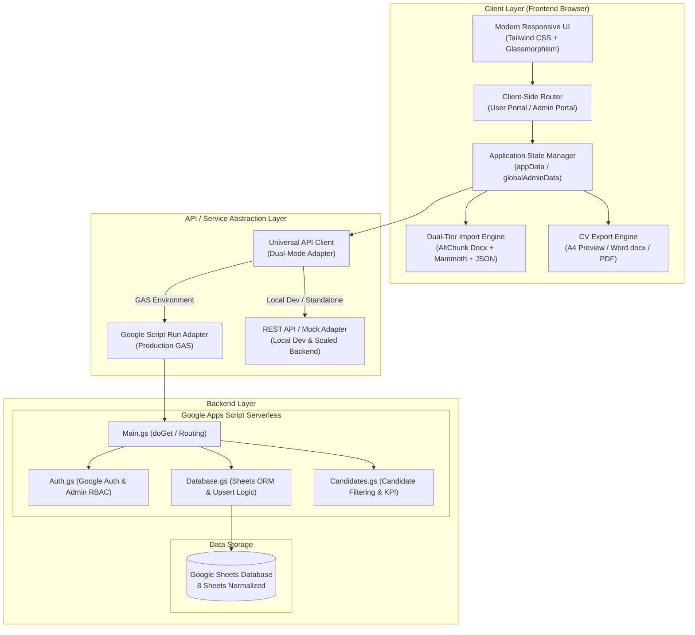
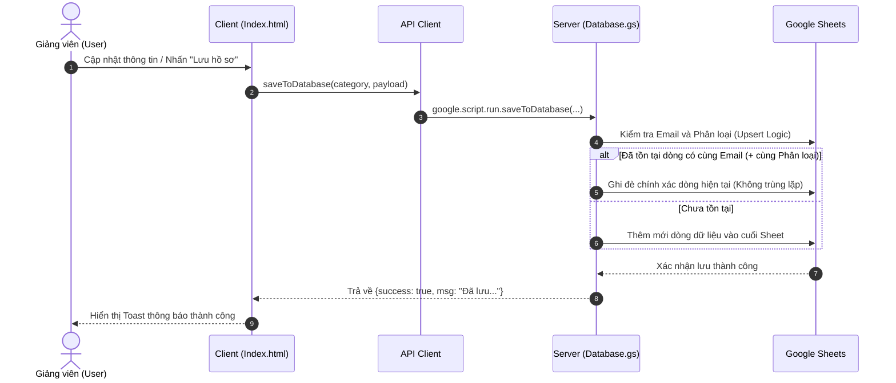
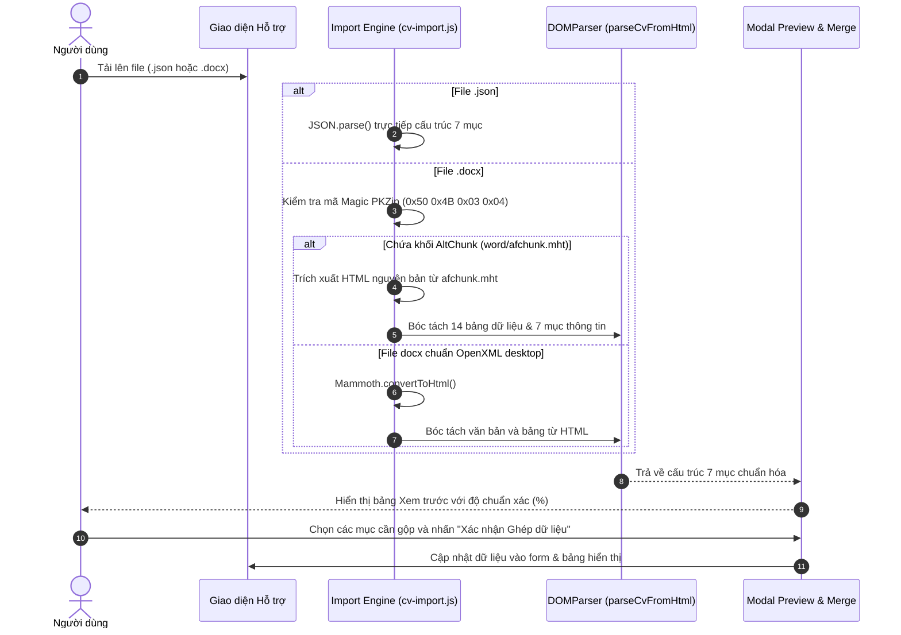

# KIẾN TRÚC HỆ THỐNG (SYSTEM ARCHITECTURE)
## Cổng Thông tin Lý lịch Khoa học HCMUTE (Scientific CV & Faculty Management Portal)

---

## 1. Tổng quan Kiến trúc (High-Level Overview)

Hệ thống được thiết kế theo mô hình **Hybrid Web Application** (Ứng dụng Web lai ghép):
- **Giai đoạn hiện tại (GAS Mode):** Chạy trực tiếp trên nền tảng **Google Apps Script (GAS)** kết hợp **Google Sheets** làm cơ sở dữ liệu phi máy chủ (Serverless), chi phí vận hành 0đ, triển khai tức thì trong hệ sinh thái Google Workspace của Trường.
- **Giai đoạn mở rộng (Production Modern Web Mode):** Được tổ chức theo mô hình **Modular Micro-Architecture**, cho phép tách rời Frontend (Vite/React/Vue hoặc Vanilla Modular) và Backend (Node.js/Express, Python FastAPI, hoặc Supabase/PostgreSQL) mà không cần viết lại nghiệp vụ cốt lõi.

---

## 2. Luồng Xử lý Dữ liệu (Data Flow)

### 2.1 Luồng Đồng bộ & Ghi đè Hồ sơ (Candidate Sync Flow)

### 2.2 Luồng Trích xuất File Mẫu 7 Mục (Dual-Tier Docx/JSON Import Flow)

---

## 3. Kiến trúc Phân quyền (Role-Based Access Control - RBAC)

Hệ thống phân định 2 vai trò cốt lõi với chuyển đổi 1 chạm (One-Click Switcher):
1. **User (Giảng viên / Ứng viên):**
   - Quản lý 7 mục hồ sơ cá nhân.
   - Xuất CV chuẩn Phụ lục III Thông tư 09/2017/TT-BGDĐT.
   - Nhập/Xuất file mẫu thông minh.
2. **Admin (Hội đồng Tuyển dụng / Quản trị viên Khoa & Trường):**
   - Xem thống kê thời gian thực toàn trường (8 KPI cards, 2 biểu đồ phân tích).
   - Tìm kiếm, lọc ứng viên theo 5 phân loại chuyên gia.
   - Xem nhanh và xuất hàng loạt CV ứng viên dạng Word (.docx) và PDF.
   - Phân quyền Quản trị viên cho email mới.
