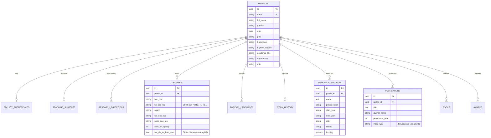

# Supabase PostgreSQL Database Schema
## HCMUTE Scientific CV & Faculty Management System

---

### 1. Entity Relationship Overview
The database is structured around the `profiles` entity, with normalized child tables cascading on deletion.

---

### 2. Table Specifications

| Tên Bảng | Mô tả | Khóa chính / Khóa ngoại |
| :--- | :--- | :--- |
| `profiles` | Thông tin cá nhân, định danh, chức danh, liên hệ | `id (UUID PK)`, `email (Unique)` |
| `faculty_preferences` | Nguyện vọng hợp tác giảng dạy, nghiên cứu, hội đồng | `profile_id (PK, FK -> profiles)` |
| `teaching_subjects` | Môn học giảng dạy chính và chuyên ngành | `id (PK)`, `profile_id (FK)` |
| `research_directions` | Các hướng nghiên cứu khoa học mũi nhọn | `id (PK)`, `profile_id (FK)` |
| `degrees` | Quá trình đào tạo đại học & sau đại học (Hệ đào tạo & tên đồ án riêng) | `id (PK)`, `profile_id (FK)` |
| `foreign_languages` | Trình độ ngoại ngữ và mức độ sử dụng | `id (PK)`, `profile_id (FK)` |
| `work_history` | Quá trình công tác chuyên môn theo thời gian | `id (PK)`, `profile_id (FK)` |
| `research_projects` | Đề tài nghiên cứu khoa học các cấp (Nhà nước, Bộ, Tỉnh, Trường) | `id (PK)`, `profile_id (FK)` |
| `publications` | Công trình khoa học, bài báo quốc tế & trong nước | `id (PK)`, `profile_id (FK)` |
| `books` | Sách và giáo trình xuất bản | `id (PK)`, `profile_id (FK)` |
| `awards` | Giải thưởng và danh hiệu KH&CN | `id (PK)`, `profile_id (FK)` |
| `admins` | Danh sách tài khoản có quyền Quản trị viên hệ thống | `id (PK)`, `email (Unique)` |

---

### 3. How to Set Up in Supabase
1. Create a new project in [supabase.com](https://supabase.com).
2. Open **SQL Editor** in the Supabase Dashboard.
3. Paste the contents of `supabase/schema.sql` and run.
4. Paste the contents of `supabase/seed.sql` to populate sample data.
5. Copy your `Project URL` and `anon public key` from **Project Settings -> API** into your `.env` file.
